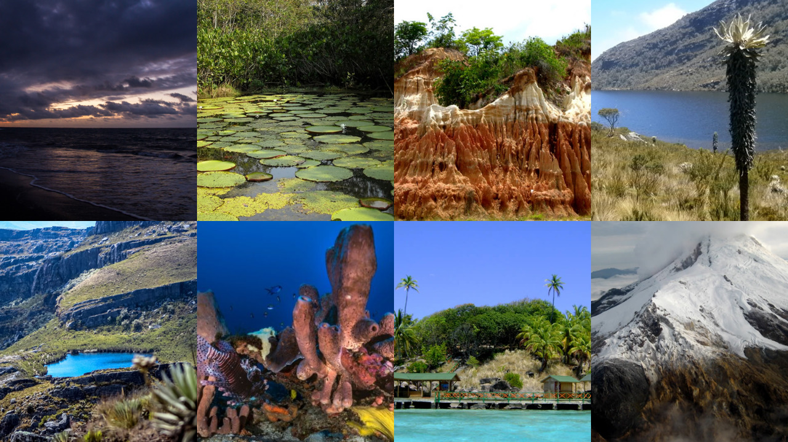
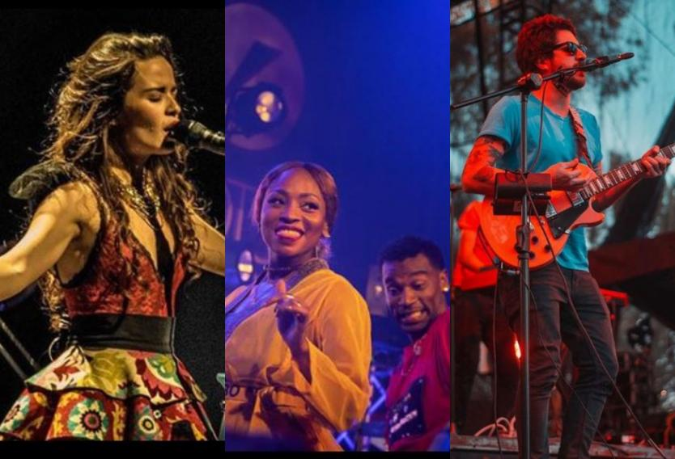
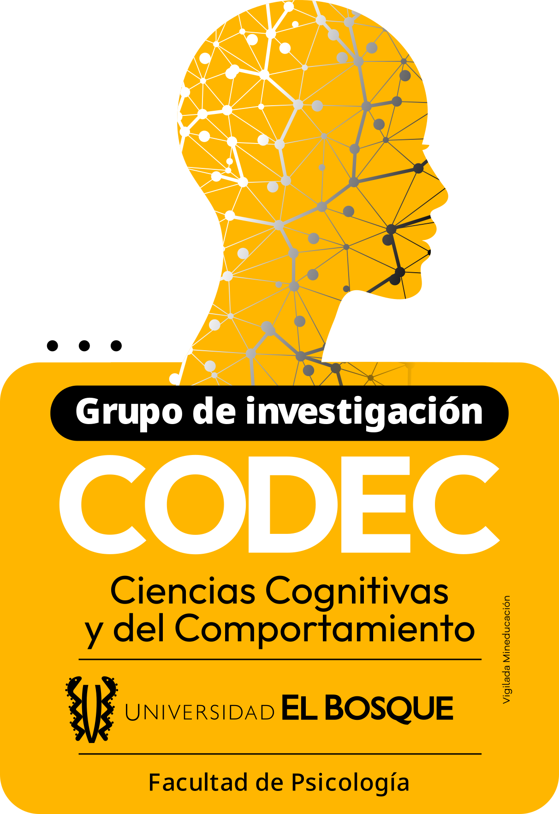
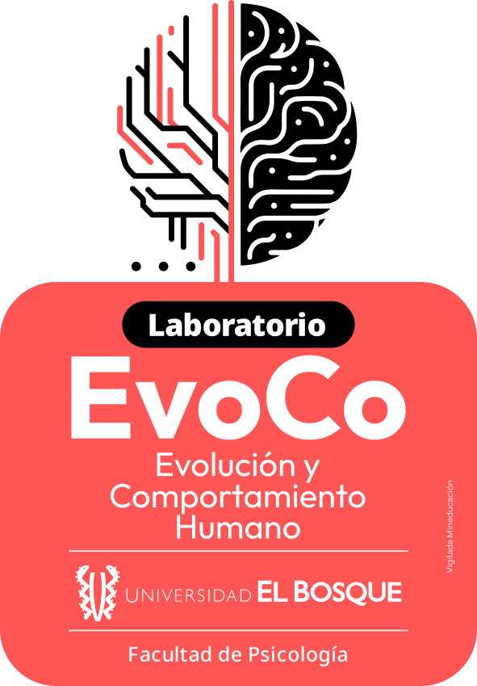
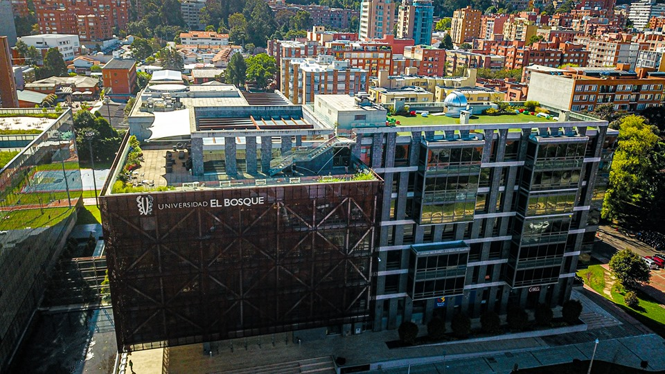

## Qué es ISHE

:::: {.columns}
::: {.column width="58%"}
Sociedad científica internacional que estudia el comportamiento humano desde un marco darwiniano: la selección natural y cultural moldea la cognición, el afecto y la conducta.

- Fundada en **1972**
- **Interdisciplinaria**: psicología, antropología, biología, primatología, psiquiatría, salud pública, enfermería y etología
- Miembros de unos **26 países**
- Revista de acceso abierto *Human Ethology*

:::
::: {.column width="42%"}
::: {.kpis style="grid-template-columns:1fr;"}
::: {.kpi}
[1972]{.n} [Año de fundación]{.l}
:::
::: {.kpi}
[~26]{.n} [Países de origen de sus miembros]{.l}
:::
::: {.kpi}
[~130]{.n} [Participantes esperados en Bogotá]{.l}
:::
:::
:::
::::

## Dónde se ha hecho antes {.smaller auto-animate="true"}

:::: {.venues .with-map}
::: {.vcol}
::: {.vhead}
Congresos internacionales
:::

- [**2026**](https://ishe.org/wp-content/uploads/2026/06/BoA_ISHE26_Final_DIGITAL.pdf){.y} Les Eyzies, Francia
- [**2024**](https://ishe.org/wp-content/uploads/2024/11/BoA_2024_v07_km.pdf){.y} Humboldt, EE. UU.
- [**2022**](https://ishe.org/wp-content/uploads/2022/08/HE_2022_37_suppl.pdf){.y} Würzburg, Alemania
- [**2021**](https://ishe.org/wp-content/uploads/2021/09/HE_Abstracts_2021.pdf){.y} En línea e internacional
- [**2018**](https://ishe.org/wp-content/uploads/2018/09/Program-ISHE-2018.pdf){.y} Santiago, Chile
- [**2016**](https://ishe.org/wp-content/uploads/2015/03/Stirling2016.pdf){.y} Stirling, Escocia
- [**2014**](https://ishe.org/wp-content/uploads/2015/03/Belem2014.pdf){.y} Belém, Brasil
- [**2012**](https://ishe.org/wp-content/uploads/2015/03/PROGRAMM_ISHE2012.pdf){.y} Viena, Austria
- [**2010**](https://ishe.org/wp-content/uploads/2015/03/Madison2010.pdf){.y} Madison, EE. UU.
:::
::: {.vcol}
::: {.vhead}
&nbsp;
:::

- [**2008**](https://ishe.org/wp-content/uploads/2015/03/Bologna2008.pdf){.y} Bolonia, Italia
- [**2006**](https://ishe.org/wp-content/uploads/2015/03/Detroit2006.pdf){.y} Detroit, EE. UU.
- [**2004**](https://ishe.org/wp-content/uploads/2015/03/Ghent2004.pdf){.y} Gante, Bélgica
- [**2002**](https://ishe.org/wp-content/uploads/2015/03/Montreal2002.pdf){.y} Montreal, Canadá
- [**2000**](https://ishe.org/wp-content/uploads/2015/03/Salamanca2000.pdf){.y} Salamanca, España
- [**1998**](https://ishe.org/wp-content/uploads/2015/03/Burnaby1998.pdf){.y} Burnaby, Canadá
- [**1996**](https://ishe.org/wp-content/uploads/2015/03/Vienna-1996.pdf){.y} Viena, Austria
- [**1994**](https://ishe.org/wp-content/uploads/2015/03/Toronto-1994.pdf){.y} Toronto, Canadá
:::
::: {.vcol}
::: {.vhead}
Summer Institutes
:::

- [**2025**](https://ishe.org/wp-content/uploads/2025/07/BoA_2025.pdf){.y} Chile y Austria
- [**2023**](https://ishe.org/wp-content/uploads/2023/07/BoA_v06_km.pdf){.y} Detroit, České Budějovice y Recife
- [**2019**](https://ishe.org/wp-content/uploads/2019/09/2019-ISHE-SI-programme.pdf){.y} Zadar, Croacia
- [**2017**](https://ishe.org/wp-content/uploads/2016/05/ISHE2017-Programme.pdf){.y} Boise, EE. UU.
- [**2015**](https://ishe.org/wp-content/uploads/2015/03/athens2015.pdf){.y} Atenas, Grecia
- [**2013**](https://ishe.org/wp-content/uploads/2015/03/AnnArbor2013.pdf){.y} Ann Arbor, EE. UU.
- [**2011**](https://ishe.org/wp-content/uploads/2015/03/programme_final.pdf){.y} Praga, República Checa
- [**2009**](https://ishe.org/wp-content/uploads/2015/03/maine2009.pdf){.y} Maine, EE. UU.
- [**2007**](https://ishe.org/wp-content/uploads/2015/03/andechs2007.pdf){.y} Andechs, Alemania

::: {.note}
Fuente: programas y libros de resúmenes en [ishe.org](https://ishe.org/conferences-and-summer-institutes/)
:::
:::
::: {.vmap}
<iframe data-id="venues-map" src="ishe_venues_map.html" width="100%" height="430" style="border:none;"></iframe>
:::
::::

::: {.notes}
ISHE organiza congreso en años pares y Summer Institute en años impares. Desde 2027 se unifican en un solo evento anual.
:::

## Dónde se ha hecho antes {auto-animate="true"}

<iframe data-id="venues-map" src="ishe_venues_map.html" width="100%" height="560" style="border:none; border-radius:6px;"></iframe>

::: {.notes}
Vista ampliada del mapa: países sombreados han sido sede de un congreso o summer institute de ISHE.
:::

## Cómo llegó ISHE a Bogotá

::: {.week .four}
::: {.day}
[2018]{.dt} Primera propuesta de Bogotá como sede del congreso de ISHE
:::
::: {.day}
[Finales de 2019]{.dt} ISHE acepta tentativamente el Summer Institute 2021 en Bogotá, con apoyo de varios trustees. La pandemia lo cancela
:::
::: {.day}
[Nueva candidatura]{.dt} Nuevo pitch pensado para un Summer Institute: diversidad biológica y cultural de Bogotá (la música como ejemplo), precios, gastronomía y conexiones aéreas
:::
::: {.day .hl}
[2027]{.dt} ISHE decide unir el congreso y el Summer Institute, y pide a Bogotá inaugurar el nuevo formato
:::
:::

:::: {.columns}
::: {.column width="55%"}

<strong>Propuesta completa:</strong> <a href="https://jdleongomez.github.io/Presentation-ISHE-2027/ishe2027.html" target="_blank">jdleongomez.github.io/Presentation-ISHE-2027/ishe2027.html</a>

:::
::: {.column width="45%"}

<strong>Colombian music map:</strong> <a href="https://jdleongomez.github.io/Colombian_music_map/" target="_blank">jdleongomez.github.io/Colombian_music_map/</a>

:::
::::

::: {.notes}
La unificación del congreso y el Summer Institute fue una decisión de ISHE, no una propuesta nuestra. ISHE aceptó la propuesta de Bogotá para inaugurar el nuevo formato.
:::

## {background-color="#1a3a25" .statement-slide}

::: {.statement}
[Bogotá inaugura el nuevo formato de ISHE]{.headline}

[Un solo evento anual que une los talleres de posgrado y el congreso]{.sub}
:::

::: {.notes}
A partir de 2027 se unifican el Summer Institute y el Congreso en un único evento anual: un día de talleres de posgrado seguido del congreso.
:::

## Por qué es importante

:::: {.columns}
::: {.column width="58%"}
- **Primera vez en Colombia** y tercer país latinoamericano en acoger a ISHE (tras Brasil y Chile)
- Programa con enfoque **transcultural** y al menos una plenaria de un investigador colombiano
- **Anfitriones**:

::: {.hostlogos}

:::
:::
::: {.column width="42%"}

:::
::::

::: {.notes}
El comité científico incluye a Jan Havlíček (presidente de ISHE), Jaroslava Varella Valentova (vicepresidenta) y a la Universidad como anfitriona local, con Milena Vásquez-Amézquita y Juan David Leongómez.
:::

## Plan del congreso: 5 a 9 de julio de 2027

::: {.week}
::: {.day}
[Lun 5]{.dt} Talleres para estudiantes de posgrado (festivo en Colombia)
:::
::: {.day}
[Mar 6]{.dt} Sesiones científicas y plenarias. Cóctel de bienvenida
:::
::: {.day .hl}
[Mié 7]{.dt} Sesiones y **sesión de pósters** por la tarde
:::
::: {.day}
[Jue 8]{.dt} Sesiones hasta el mediodía. Tarde de recorrido por Bogotá (Museo del Oro, Plaza de Bolívar, Monserrate)
:::
::: {.day}
[Vie 9]{.dt} Sesión final y cena de clausura
:::
:::

- **130 participantes**, en un hotel de Chicó Norte (en negociación)
- Cinco plenarias (por confirmar), con comité científico internacional
- **Febrero de 2027:** inscripciones y convocatoria de resúmenes. **Abril:** cierre de resúmenes
- Viaje opcional a Cartagena y Tayrona al terminar, pagado por cada participante

::: {.notes}
Sede principal: hotel en Chicó Norte (el Estelar Parque de la 93 es la opción líder). La sesión de pósters del miércoles es la actividad que proponemos hacer en la Universidad.
:::

## Un congreso sin ánimo de lucro

::: {.kpis}
::: {.kpi}
[€107.000]{.n} [Gasto estimado (≈ COP 400 millones)]{.l}
:::
::: {.kpi}
[€11.750]{.n} [Ingreso previsto por inscripciones]{.l}
:::
::: {.kpi}
[€95.500]{.n} [Cubiertos por ISHE (≈ COP 356 millones)]{.l}
:::
:::

::: {.splitbar}
::: {.a}
11%
:::
::: {.b}
89% lo pone ISHE
:::
:::

::: {.flow}
::: {.box .gold}
**ISHE** fondos de la sociedad
:::
::: {.arrow}
→
:::
::: {.box}
**Proveedores** hotel, catering, buses, guías
:::
::: {.arrow}
&nbsp;
:::
::: {.box .grey}
**Universidad El Bosque** ningún dinero pasa por la Universidad
:::
:::

::: {.note}
Presupuesto preliminar (octubre de 2026), en revisión con ISHE; incluye 10% de contingencia. ISHE paga directamente a los proveedores. No se proyecta excedente.
:::

::: {.notes}
Insistir en que el modelo evita cualquier trámite financiero para la Universidad. Los ingresos por patrocinio (Alcaldía, Universidad, otros) están en cero en el presupuesto actual y quedan por gestionar.
:::

## ISHE invierte en sus estudiantes

:::: {.columns}
::: {.column width="55%"}
- **66 de 130** participantes con inscripción gratuita (oficiales, plenaristas y estudiantes que presentan como primeros autores*)
- **46 estudiantes alojados** por ISHE durante 5 noches: ≈ €13.400 (≈ COP 50 millones), un octavo del presupuesto total
- **Taller de posgrado** el lunes, antes del congreso
- **Premios** a los mejores pósters
:::
::: {.column width="45%"}
**Inscripción temprana**

| | Socio ISHE | No socio |
|:--|--:|--:|
| Estudiante | €100 | €150 |
| Investigador | €200 | €320 |

::: {.note}
Cifras preliminares del presupuesto de ISHE (octubre de 2026).
:::
:::
::::

::: {.note}
\* Estudiantes de cualquier nivel, aunque tradicionalmente la mayoría son de doctorado (también participan de pregrado y maestría).
:::

::: {.notes}
Los estudiantes alojados corresponden a la Opción B (hotel cercano, cotización de bh Parque 93). Las tarifas son las estándar de ISHE (referencia: Les Eyzies 2026).
:::

## Participar en ISHE ya ha dado resultados

::: {.kpis style="grid-template-columns:repeat(5,1fr);"}
::: {.kpi}
[2016]{.n} [Stirling (congreso)]{.l}
:::
::: {.kpi}
[2018]{.n} [Santiago (congreso)]{.l}
:::
::: {.kpi}
[2019]{.n} [Zadar (Summer Institute)]{.l}
:::
::: {.kpi}
[2023]{.n} [Recife (Summer Institute, invitado por ISHE)]{.l}
:::
::: {.kpi}
[2025]{.n} [Valparaíso (Summer Institute, invitado por ISHE)]{.l}
:::
:::

::: {.note style="font-size:0.58em; color:#1a3a25; text-align:center; margin:0.35em 0;"}
También soy miembro fundador y de la junta de la Latin American Association for Human Behavioral and Evolutionary Sciences (LAAHBES).
:::

::: {.kpis .four}
::: {.kpi}
[11+]{.n} [Craig Roberts, trustee y expresidente de ISHE]{.l}
:::
::: {.kpi}
[8+]{.n} [Jan Havlíček, presidente de ISHE]{.l}
:::
::: {.kpi}
[6+]{.n} [Jaroslava Varella Valentova, vicepresidenta de ISHE]{.l}
:::
::: {.kpi}
[4+]{.n} [Ana María Fernández, secretaria de ISHE]{.l}
:::
:::

**Participar en ISHE se convirtió en una red de colaboración con quienes hoy la dirigen. Ser sede multiplica esa oportunidad para estudiantes y profesores de la Universidad.**

::: {.notes}
Este es un solo caso, el mío: lo menciono antes de que alguien lo señale.
:::

## Resultados esperados

::: {.cards}
::: {.card}
[Científicos]{.t}
Colaboraciones y proyectos con unos 130 investigadores internacionales. Contactos para profesores y estudiantes de varias facultades.
:::
::: {.card}
[Formación]{.t}
Día de talleres de posgrado y pósters de estudiantes de la Universidad. Los primeros autores de una ponencia o póster aceptado, estudiantes de la Universidad incluidos, tienen inscripción y alojamiento cubiertos por ISHE
:::
::: {.card}
[Visibilidad]{.t}
La Universidad como anfitriona en el programa, el libro de resúmenes, la web, las credenciales y los materiales del congreso. Los asistentes conocen el campus en la sesión de pósters, con difusión en los canales de ISHE y de la Universidad
:::
::: {.card}
[Redes]{.t}
Invitaciones futuras, posibles intercambios y presencia de la Universidad en la investigación evolutiva de América Latina. LAAHBES, iniciativa latinoamericana liderada en su mayoría por miembros de ISHE, consolidó su plan en los encuentros de ISHE
:::
:::

::: {.note style="font-size:0.62em; color:#1a3a25;"}
**Compromiso:** informe de resultados al Consejo y a la Vicerrectoría después del congreso, con asistentes por país, pósters y participantes de la Universidad, colaboraciones iniciadas y presencia en medios.
:::

::: {.notes}
Estos son resultados esperados, no garantizados.
:::

## Qué solicitamos a la Universidad

::: {.cards}
::: {.card .gold}
[Sesión de pósters en la Universidad]{.t}
Miércoles 7 de julio de 2027, por la tarde: espacio, montaje, cóctel y, si es posible, buses. Detalle en la siguiente diapositiva.
:::
::: {.card}
[Aval institucional]{.t}
Aval del Consejo de Investigaciones y carta de apoyo de la Vicerrectoría.
:::
::: {.card}
[Comunicaciones y diseño]{.t}
Apoyo del equipo de diseño en la imagen del congreso y difusión en los canales institucionales.
:::
::: {.card}
[Voluntarios]{.t}
Estudiantes de la Universidad como apoyo del comité local (camisetas y refrigerios previstos en el presupuesto de ISHE).
:::
:::

::: {.notes}
Pedir primero el aval y la sesión de pósters; los demás puntos son complementarios.
:::

## Sesión de pósters: miércoles 7 de julio, tarde

Probablemente unos **30 a 50 pósters**, unos **130 asistentes**.

::: {.tier}
::: {.chip}
Importante
:::
::: {.txt}
**Auditorio principal** y **montaje**: paneles o caballetes para pósters en formato A0 vertical (84 × 119 cm, por confirmar con el comité científico)
:::
:::

::: {.tier}
::: {.chip .gold}
Deseable
:::
::: {.txt}
**Vino y cóctel** durante la sesión. Referencia: cotización del hotel de COP 34.000 por persona (≈ COP 4,4 millones para 130 personas)
:::
:::

::: {.tier}
::: {.chip .soft}
Increíble
:::
::: {.txt}
**Buses** hotel-Universidad, ida y vuelta: ~4 buses
:::
:::

::: {.note}
ISHE aporta el programa, la evaluación y los premios de pósters. Idealmente confirmar en noviembre de 2026, antes de firmar el contrato con el hotel.
:::

::: {.notes}
Si la sesión se hace en la Universidad, ISHE deja de pagar el café de la tarde del miércoles en el hotel y suma el costo de los buses (ahorro neto de unos €340). Si la Universidad cubre los buses, ISHE ahorra además unos €945.
:::

## Próximos pasos

:::: {.columns}
::: {.column width="55%"}
- **Noviembre de 2026:** respuesta sobre la sesión de pósters; contrato con el hotel
- **Noviembre-diciembre:** presupuesto final aprobado por ISHE
- **Febrero de 2027:** abren inscripciones y convocatoria de resúmenes
- **5-9 de julio de 2027:** congreso en Bogotá
:::
::: {.column width="45%"}

<strong>Sitio web del congreso</strong>

<a href="" target="_blank"></a>

::: {.note}
Sitio creado y mantenido en un 100% por mí.
:::

Juan David Leongómez 
Universidad El Bosque
:::
::::
